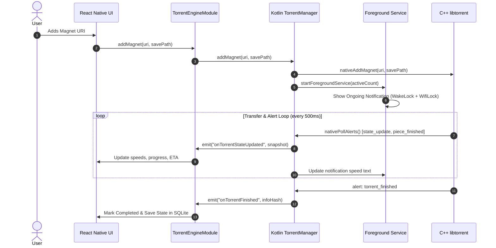

# TorrentFlow Mobile — Architecture Documentation

## 1. System Architecture Overview

TorrentFlow Mobile is architected around a multi-tier decoupled structure designed to optimize CPU efficiency, background reliability, and cross-platform maintainability.

```
+-------------------------------------------------------------------+
|               React Native / Expo UI Layer                        |
|  Expo Router | Screens (Tabs/Modals) | Reusable Design System    |
+---------------------------------+---------------------------------+
                                  |
            [TurboModule / NativeEventEmitter Bridge]
                                  |
+---------------------------------v---------------------------------+
|                    Android Native Layer (Kotlin)                  |
|  TorrentDownloadService (dataSync) | Notification Manager         |
|  TorrentManager Orchestrator       | WakeLock & WifiLock Holders  |
+---------------------------------+---------------------------------+
                                  |
                         [JNI C++ Boundary]
                                  |
+---------------------------------v---------------------------------+
|               Native BitTorrent Engine (C++17)                    |
|  rasterbar libtorrent 2.1.x       | Boost ASIO / OpenSSL          |
|  DHT / PEX / Trackers / Disk I/O   | Fast Resume Data Serializer   |
+-------------------------------------------------------------------+
```

---

## 2. Component Layers and Responsibilities

### Tier 1: Frontend (React Native & Expo Router)
- **Directory**: `app/` and `src/`
- **Responsibilities**:
  - Presentation and user interaction (Material 3 & Slate design system).
  - Client-side SQLite synchronization via `DatabaseService` (`expo-sqlite`).
  - Safe-area responsive layout across phone and tablet dimensions.
  - Haptic feedback and native clipboards/document pickers.
  - Dispatches commands (`addMagnet`, `pauseTorrent`, `resumeTorrent`, `removeTorrent`) to `TorrentEngine`.
  - Subscribes to real-time telemetry updates.

### Tier 2: Python Application Logic
- **Directory**: `python/`
- **Responsibilities**:
  - `python/core/bencode.py`: High-performance bencoding encoder and decoder handling standard BitTorrent specifications.
  - `python/core/magnet.py`: Comprehensive Magnet URI parser decoding hex (40-character) and base32 (32-character) hashes, display names, and multi-tracker arrays.
  - `python/torrent/metadata.py`: Extracts info-hash (SHA1), single-file and multi-file directory trees, and piece layout blocks.
  - `python/torrent/state_machine.py`: Deterministic operational state machine tracking state transitions (`CHECKING` -> `DOWNLOADING_METADATA` -> `DOWNLOADING` -> `FINISHED` -> `SEEDING` / `PAUSED` / `ERROR`).
  - `python/torrent/file_selector.py`: Maps file priorities (0=Skip, 1=Low, 4=Normal, 7=High) to discrete piece index ranges.
  - `python/database/`: SQLite migrations, transaction safety, fast resume metadata, and duplicate hash prevention.
  - `python/services/session_manager.py`: Central session orchestrator.

### Tier 3: Native Android Layer (Kotlin)
- **Directory**: `android/`
- **Responsibilities**:
  - `TorrentDownloadService`: Android Foreground Service configured with `android:foregroundServiceType="dataSync"` for Android 14+ (API 34).
  - Acquires `PowerManager.PARTIAL_WAKE_LOCK` and `WifiManager.WIFI_MODE_FULL_HIGH_PERF` to ensure continuous peer-to-peer data transfer with screen off.
  - Renders a low-priority, non-intrusive status bar notification with real-time transfer speeds and direct Pause All / Stop action buttons.
  - `TorrentManager`: Singleton coordinating alert polling loop and dispatching events to React Native via `RCTDeviceEventEmitter`.
  - `TorrentEngineModule`: React Native NativeModule bridge exposing asynchronous methods to JavaScript.

### Tier 4: Native BitTorrent Core (C++ libtorrent 2.1.x)
- **Directory**: `native/`
- **Responsibilities**:
  - Real BitTorrent peer-to-peer protocol execution.
  - Distributed Hash Table (Mainline DHT / BEP 5).
  - Peer Exchange (PEX / BEP 11) and Local Service Discovery (LSD / BEP 14).
  - Multi-threaded piece verification, file pre-allocation, and disk writing.
  - Fast resume data generation saving piece bitmasks and file download tokens to prevent re-checking on restart.

---

## 3. Data Flow Diagram



